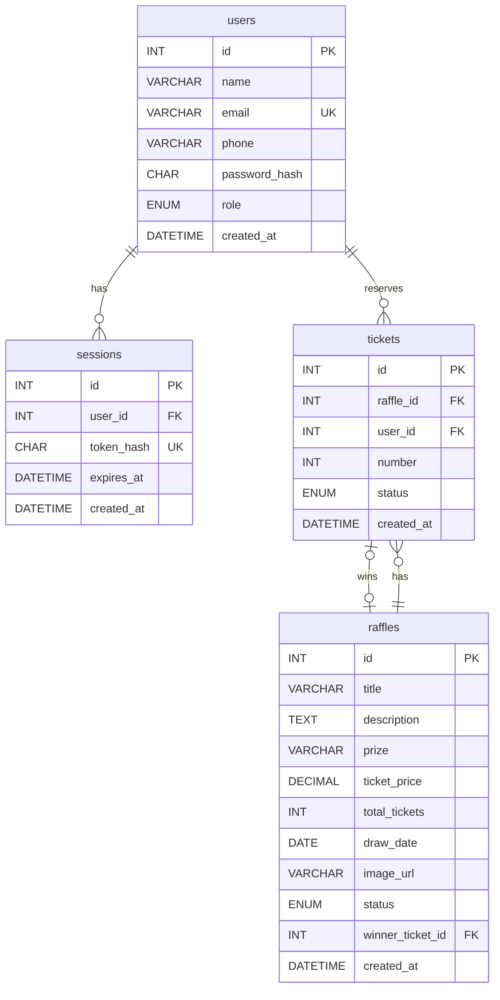

# Rifa Online API

API de uma plataforma de rifas online, no estilo das rifas de influenciadores: o administrador cria uma rifa com um prêmio, um valor por número e uma quantidade de números. Quem está cadastrado escolhe e reserva seus números. Quando o pagamento é confirmado, o número entra no sorteio, e no fim a API sorteia um ganhador entre os números pagos.

Este é o **projeto de referência da entrega final de Linguagens de Servidor**. Ele mostra, funcionando, tudo o que o projeto de vocês precisa ter: banco modelado, CRUD com JSON, relacionamentos com `JOIN`, arquitetura em camadas, validação, tratamento de erros, autenticação e collection.

> Projeto educacional. Nenhum pagamento é processado de verdade: o administrador apenas marca o número como pago. No Brasil, rifas com dinheiro real dependem de autorização do governo.

## Tecnologias

- Node.js com o módulo `http` nativo, sem framework
- MySQL com o driver `mysql2`
- `bcrypt` para as senhas
- `dotenv` para as variáveis de ambiente

## Como rodar

### Pré-requisitos

- Node.js 20 ou mais recente
- MySQL 8 (ou MariaDB 10.6 ou mais recente)

### Passo a passo

1. Clone o repositório e instale as dependências:

   ```bash
   git clone https://github.com/professor-correa/linguagem-de-servidor.git
   cd linguagem-de-servidor
   npm install
   ```

2. Crie o banco rodando no MySQL Workbench, nesta ordem, os arquivos `database/schema.sql` e `database/seed.sql`.

3. Copie o `.env.example` para `.env` e preencha com o usuário e a senha do seu MySQL.

4. Suba o servidor:

   ```bash
   npm run dev
   ```

   A API fica em `http://localhost:3000`.

### Usuários de teste

O `seed.sql` já cria três usuários:

| Papel | Email | Senha |
| --- | --- | --- |
| admin | `admin@rifaonline.dev` | `admin-rifa` |
| customer | `maria@email.com` | `maria-rifa` |
| customer | `joao@email.com` | `joao-rifa` |

## Banco de dados



- Um **usuário** pode ter várias **sessões** abertas (um login no celular e outro no computador, por exemplo).
- Um **usuário** reserva vários **números**, e uma **rifa** tem vários **números**. A tabela `tickets` é o que liga os dois.
- A chave única `(raffle_id, number)` impede que o mesmo número seja vendido duas vezes na mesma rifa. Quem garante isso é o banco, não o código: se duas pessoas tentarem ao mesmo tempo, só a primeira consegue.
- `winner_ticket_id` aponta para o número sorteado. Como rifas e números se referenciam, essa chave é criada no fim do `schema.sql`, depois das duas tabelas.

## Arquitetura

O projeto usa MVC adaptado para API. Não existe camada de view, porque a resposta é sempre JSON.

```txt
database/
  schema.sql
  seed.sql
docs/
  collection/
src/
  server.js
  config/
    db.js
  routes/
    index.js
    auth-routes.js
    raffle-routes.js
    ticket-routes.js
  controllers/
    auth-controller.js
    raffle-controller.js
    ticket-controller.js
  models/
    user-model.js
    session-model.js
    raffle-model.js
    ticket-model.js
  validators/
    helpers.js
    auth-validator.js
    raffle-validator.js
    ticket-validator.js
  utils/
    http.js
    handle-error.js
    parse-id.js
    password.js
    token.js
```

| Camada | Responsabilidade |
| --- | --- |
| `routes` | cada arquivo é uma tabela de rotas: método, caminho, controller e quem pode acessar. O `index.js` encontra a rota, confere o login e chama o controller |
| `controllers` | leem a requisição, chamam o validador e o model, e escolhem o status da resposta |
| `models` | únicos arquivos com SQL. Convertem as linhas do banco para o formato da API (`ticket_price` vira `ticketPrice`, `DECIMAL` vira número) |
| `validators` | conferem o que o cliente mandou e devolvem só os campos permitidos, já limpos |
| `utils` | funções usadas em vários lugares: respostas JSON, tratamento central de erros, senha e token |

### Por que essa arquitetura

Antes da separação, cada rota fazia tudo: lia o corpo, validava, montava o SQL e respondia. Uma mudança no banco obrigava a mexer em várias rotas, e era difícil achar onde cada coisa acontecia.

Com as camadas, cada mudança tem um lugar certo. Quando a listagem de rifas passou a mostrar quantos números foram vendidos, só o `raffle-model.js` mudou: a consulta ganhou um `LEFT JOIN` com `COUNT`, e o controller e as rotas continuaram iguais. Quando o login passou a ser exigido em algumas rotas, bastou acrescentar `access: 'admin'` na tabela de rotas, sem tocar em nenhum controller.

## Autenticação

1. No cadastro, a senha é transformada em hash com `bcrypt` e só o hash vai para o banco.
2. No login, o `bcrypt` compara a senha digitada com o hash. Se bater, a API gera um token aleatório e devolve para o cliente.
3. No banco fica só o hash SHA-256 do token, na tabela `sessions`, com data de validade.
4. Nas rotas protegidas, o cliente manda o token no cabeçalho:

   ```txt
   Authorization: Bearer 3f9c...e81a
   ```

5. O logout apaga a sessão do banco, e o token deixa de valer na hora.

Cada rota declara quem pode acessar:

| `access` | Quem pode | Sem token | Token de customer |
| --- | --- | --- | --- |
| (sem) | qualquer pessoa | permitido | permitido |
| `authenticated` | qualquer usuário logado | 401 | permitido |
| `admin` | só administradores | 401 | 403 |

## Endpoints

Todas as respostas são em JSON. Os erros seguem sempre o formato `{ "error": "mensagem" }`.

### Autenticação

| Método | Rota | Acesso | Descrição | Status |
| --- | --- | --- | --- | --- |
| POST | `/api/auth/register` | público | cadastra um customer | 201, 400, 409 |
| POST | `/api/auth/login` | público | devolve token e usuário | 200, 400, 401 |
| POST | `/api/auth/logout` | logado | encerra a sessão | 204, 401 |
| GET | `/api/auth/me` | logado | dados do usuário logado | 200, 401 |

### Rifas

| Método | Rota | Acesso | Descrição | Status |
| --- | --- | --- | --- | --- |
| GET | `/api/raffles` | público | lista, aceita `?status=` e `?search=` | 200, 400 |
| GET | `/api/raffles/:id` | público | detalhe, números ocupados e ganhador | 200, 400, 404 |
| POST | `/api/raffles` | admin | cria | 201, 400, 401, 403 |
| PUT | `/api/raffles/:id` | admin | atualiza | 200, 400, 401, 403, 404, 409 |
| DELETE | `/api/raffles/:id` | admin | exclui se não tiver números vendidos | 204, 400, 401, 403, 404, 409 |
| POST | `/api/raffles/:id/draw` | admin | sorteia entre os números pagos | 200, 400, 401, 403, 404, 409 |

### Números

| Método | Rota | Acesso | Descrição | Status |
| --- | --- | --- | --- | --- |
| POST | `/api/raffles/:id/tickets` | logado | reserva um número | 201, 400, 401, 404, 409 |
| GET | `/api/raffles/:id/tickets` | admin | números da rifa com os compradores | 200, 400, 401, 403, 404 |
| GET | `/api/me/tickets` | logado | números do usuário logado | 200, 401 |
| PATCH | `/api/tickets/:id/pay` | admin | marca um número como pago | 200, 400, 401, 403, 404 |

Rota inexistente responde 404, método não aceito em uma rota que existe responde 405 com o cabeçalho `Allow`, e qualquer erro inesperado responde 500 sem derrubar o servidor.

### Exemplos

Login:

```txt
POST /api/auth/login
Content-Type: application/json

{ "email": "maria@email.com", "password": "maria-rifa" }
```

```txt
HTTP/1.1 200 OK
Content-Type: application/json; charset=utf-8

{
  "token": "3f9c5b...e81a",
  "user": { "id": 2, "name": "Maria Souza", "email": "maria@email.com", "phone": "11988887777", "role": "customer", "createdAt": "2026-10-25 22:10:00" }
}
```

Reserva de número:

```txt
POST /api/raffles/1/tickets
Authorization: Bearer 3f9c5b...e81a
Content-Type: application/json

{ "number": 50 }
```

```txt
HTTP/1.1 201 Created
Content-Type: application/json; charset=utf-8

{ "id": 10, "raffleId": 1, "userId": 2, "number": 50, "status": "reserved", "createdAt": "2026-10-25 22:12:41" }
```

Número já vendido:

```txt
HTTP/1.1 409 Conflict
Content-Type: application/json; charset=utf-8

{ "error": "Number 7 is already taken" }
```

Sorteio:

```txt
POST /api/raffles/1/draw
Authorization: Bearer 7a21d0...4c9f
```

```txt
HTTP/1.1 200 OK
Content-Type: application/json; charset=utf-8

{ "raffleId": 1, "winner": { "ticketId": 4, "number": 42, "name": "João Lima" } }
```

## Collection

A collection do Postman está em `docs/collection/raffle-api.postman_collection.json`.

1. No Postman, clique em **Import** e arraste o arquivo.
2. Rode **Login as admin** e **Login as customer**, na pasta `auth`. Os tokens ficam salvos nas variáveis da collection.
3. As outras requisições já usam os tokens sozinhas. A URL base fica na variável `baseUrl`.

Para começar do zero, rode de novo o `schema.sql` e o `seed.sql`.

## Referências

NODE.JS. HTTP. Node.js Documentation. Disponível em: https://nodejs.org/api/http.html. Acesso em: 25 out. 2026.

NODE.JS. Crypto. Node.js Documentation. Disponível em: https://nodejs.org/api/crypto.html. Acesso em: 25 out. 2026.

MYSQL2. Documentation. Disponível em: https://sidorares.github.io/node-mysql2/docs. Acesso em: 25 out. 2026.

OWASP FOUNDATION. Password Storage Cheat Sheet. Disponível em: https://cheatsheetseries.owasp.org/cheatsheets/Password_Storage_Cheat_Sheet.html. Acesso em: 25 out. 2026.

OWASP FOUNDATION. Session Management Cheat Sheet. Disponível em: https://cheatsheetseries.owasp.org/cheatsheets/Session_Management_Cheat_Sheet.html. Acesso em: 25 out. 2026.

MOZILLA. HTTP response status codes. MDN Web Docs. Disponível em: https://developer.mozilla.org/pt-BR/docs/Web/HTTP/Status. Acesso em: 25 out. 2026.

## Declaração de uso de IA

ANTHROPIC. Claude (Opus 5.5). Ferramenta de inteligência artificial generativa.
Data de uso: 25 out. 2026.
Finalidade: apoio na escrita do código, dos testes e da documentação deste projeto de referência, com revisão do professor.
Arquivos impactados: todo o repositório.
